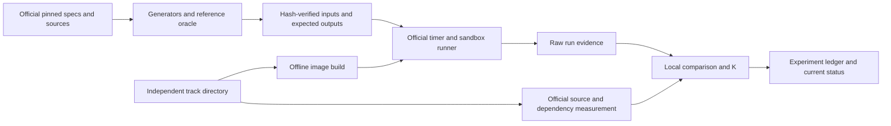

# Architecture

Status: workspace structure accepted; solution designs are candidates awaiting harness measurements.

## System boundaries

Use one standalone batch executable per track. Each executable parses its inputs, computes exact results, emits the required file, and terminates. No service, database, network, cross-run cache, or shared runtime is required by these tasks. Preprocessing of a dataset belongs inside the measured execution.

Organizer basis, **Clarifications → One repo or several?**: “Each folder is its own build context.” Consequently, root tools, tests, datasets, and docs cannot be build dependencies of a submitted track. A useful helper shared by two solutions must be copied into both folders and its source cost paid in each.

## Directory contract

| Path | Ownership and lifecycle |
|---|---|
| `resources/upstream/` | Preserve retrieved source bytes. Record upstream version; changes go in our tooling, not this snapshot. |
| `resources/upstream-manifest.json` | Provenance and exact Git blob identities; records omissions. |
| `docs/context.md` | User-provided organizer context snapshot, not an automatically refreshed page. |
| `docs/PRD.md`, `architecture.md`, `decisions.md` | Requirements, design, and reasons for changes. |
| `docs/progress.md` | Canonical task list and completion evidence. |
| `docs/status.md` | Small current-state summary and latest validated performance. |
| `data/generated/track-x/{scale}-seed{n}/` | Rebuildable input files; ignored by Git. |
| `data/downloads/` | Future direct downloads, if needed; ignored by Git. |
| `results/setup/` | Checked-in compact preparation evidence. |
| `results/runs/{run-id}/` | Immutable per-run output, logs, metadata; ignored raw artifacts. |
| `results/reference-outputs/` | Oracle outputs by dataset identity; never included in solution images. |
| `benchmarks/experiments.csv` | Small tracked index pointing to raw evidence and board runs. |
| `tools/` | Local automation; Python standard library preferred. |
| `tests/` | Our fixtures and integration checks; upstream tests stay with upstream. |
| `track-a/` through `track-d/` | Created when solution work starts, initially copied from the starter. |

Keep each future track flat unless its implementation needs more structure: `Dockerfile`, `.speed-demon.toml`, `README.md`, `PERF.md`, language manifest where applicable, and a small source file or `src/` directory. Use ordinary readable names. Source compression and formatter tricks undermine maintainability and do not establish performance.

## Candidate data flows

These are engineering hypotheses derived from each spec's Task, Input, and Reference behaviour sections. They are not measured findings.

### A: parse → group → exact percentiles → ordered output

Start with a scalar byte parser, exact endpoint interning, a compact hour index, and vectors of uint32 latencies per group. Parse only timestamp fields needed for the hour; cover October/November rollover. Keep groups until the file ends because the spec promises no disorder bound. Sort endpoints bytewise and traverse hours chronologically. Baseline percentile extraction sorts each group; compare selection and contiguous two-pass storage only after profiling. `(p*n+99)/100 - 1` is the zero-based index, using wide arithmetic.

Potential parallel unit: newline-aligned input chunks with private aggregation and an exact merge. Measure merge overhead and memory multiplication; never average per-chunk percentiles.

### B: queries → selective index → ordered answers

Read queries first and intern their terms. Build document-unique postings only for terms needed by queries. Preserve ASCII-only case conversion and treat all high bytes as separators. Start with sorted uint32 postings and a raw-document offset table; verify phrases by tokenizing candidate documents from the rarest useful term. Candidate alternatives are positional postings or document token IDs, and dense bitmaps for common terms. Mixed boolean expressions must retain left-to-right semantics; intersection reordering is only valid within a proven equivalent operation. Phrase verification must count unmatched tokens in positions and preserve repeated words.

Measure total indexing plus query time; the optimum on sample may differ at full scale. Sum result IDs in 64 bits and emit only the ten smallest, without an unnecessary full result sort when traversal already yields ascending IDs.

### C: lookup → CSV state machine → exact aggregate → sorted output

Compare a direct region lookup table sized from the maximum lookup ID with a hash table. Bounds-check record IDs above that maximum and map both holes and out-of-range values to `_UNMATCHED`. Track fields with quote-aware parsing, unescape names for equality, and count unescaped byte lengths for names and notes. Notes need no retained string if only byte length is used. Parse amounts into signed integer cents and initialize min/max from the first record in a group. Distinct-name storage must resolve hash collisions by exact bytes.

Start single-threaded. If parallel parsing becomes worthwhile, find valid record boundaries with quote state; splitting on arbitrary LF is invalid. Combining per-worker distinct counts requires set union, not addition.

### D: parse → compact adjacency → exact searches → input-order output

Baseline: compressed sparse row adjacency, uint32 heads and weights, 64-bit distances, binary-heap Dijkstra, and reusable distance storage with touched-node reset or generation stamps. Handle `s == t` before no-edge shortcuts. An unreachable no-in target can be rejected from actual in-degree when `s != t`. Retain all edges initially; deduplication is a timed tradeoff.

Next candidate: forward and reverse CSR with bidirectional Dijkstra and a proven stopping condition. Do not stop at the first meeting; zero weights and asymmetric directions need explicit tests. A worker pool can parallelize independent queries with private search state and indexed answers. Compare 1/2/4/6/12 workers, including their memory cost. Radix heaps, relabeling, or heavy routing indexes require evidence that their total build-plus-query savings justify complexity.

## Technology decision boundary

Shortlist C++20 with GCC 15 and Rust with the allowlisted pinned toolchain. Python remains the official oracle and local orchestration language. Select a solution language after equivalent small prototypes can be measured under the same harness; favor team fluency if performance differences are small. No external runtime dependency is assumed initially. See [research](research.md) for the comparison and experiments.
